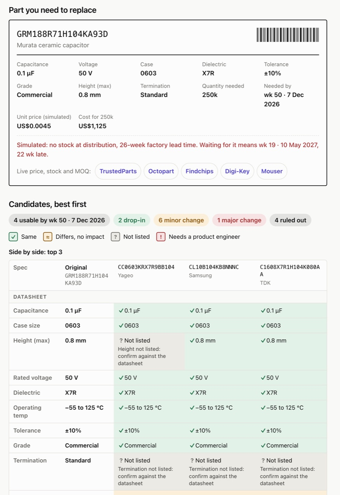

# MLCC Alternate Finder

**Live demo: [andreevazquez.github.io/mlcc-alternate-finder](https://andreevazquez.github.io/mlcc-alternate-finder/)**

Your capacitor is on allocation. This tool screens alternates against explicit substitution rules, then shows what engineering must review, when each part can be in production, and what it costs.

[](https://andreevazquez.github.io/mlcc-alternate-finder/?scenario=1)

> **Screening aid, not an engineering approval.** Verify every candidate's current datasheet, lifecycle, qualification, fit and availability before approving a production substitution.

## What it does

**Problem.** When a multilayer ceramic capacitor (MLCC) goes on allocation in an EMS or automotive-electronics plant, finding an alternate is manual and slow:
- A planner searches distributors.
- An engineer checks specs one by one.
- Nobody sizes the approval path until the line is already waiting.

**Approach.** Enter a manufacturer part number or a raw BOM line (`CAP CER 10UF 10V X5R 0805`). The finder works in four steps:
- **Live data.** It pulls the specs, stock and offers from authorised distributors.
- **Rules.** It checks every candidate against the substitution rules a component engineer applies: capacitance, case, voltage, dielectric, temperature, tolerance, grade, termination and lifecycle.
- **Review flags.** It flags what still needs an engineer: DC bias, height and termination.
- **Plan.** It builds an approval path and a supply date for each candidate.

**Outcome.** A ranked shortlist with:
- The reason each part passes, needs review or fails.
- The type of change: drop-in, minor or major.
- The date it can be in production, on time or weeks late against your need date.
- The cost against the original, compared with simply waiting for the original part.

## Scenario walkthrough

Each link opens the live page with the scenario already run. The same scenarios are one click away at the top of the page.

1. **[0.1 µF on allocation](https://andreevazquez.github.io/mlcc-alternate-finder/?scenario=1).** You need 250k of a Murata `GRM188R71H104KA93D` in 4 weeks, and it has no stock and 26 weeks of lead time.
   - Waiting means 22 weeks late.
   - The finder shows 4 alternates usable in time: 2 drop-ins from Murata's own range, 6 minor changes from other manufacturers, and 1 major change.
   - A Yageo, a Samsung and a TDK part come out on top. Each carries a DC-bias flag, because a different manufacturer means a different DC-bias curve.
2. **[Automotive line](https://andreevazquez.github.io/mlcc-alternate-finder/?scenario=2).** The same value, AEC-Q200, 50k in 12 weeks.
   - Every commercial part is ruled out.
   - Every remaining change is major, because an automotive customer must approve it (PPAP).
   - Each candidate is flagged for termination. The flag asks whether this location on the board needs flexible termination.
3. **[Upgrade a BOM line](https://andreevazquez.github.io/mlcc-alternate-finder/?scenario=3).** A 10 µF X5R part from a BOM description, in *Better than original* mode.
   - Only parts that improve something and give nothing up are kept: three parts with a higher voltage rating, one of them also X7R.
4. **[Medical device](https://andreevazquez.github.io/mlcc-alternate-finder/?scenario=4).** 100 pF C0G for a medical design.
   - Nothing qualifies.
   - The page explains why: AEC-Q200 doesn't replace a medical-grade series.
5. **[Live part number](https://andreevazquez.github.io/mlcc-alternate-finder/?scenario=5).** The same end-of-life Murata part with live data.
   - You get Mouser's offers (stock, MOQ, packaging and price breaks) and the replacement Mouser recommends.
   - The alternates come from Mouser's catalog, checked against the same rules.

Any other part number works too. A deep link such as [`#GRM188R71H104KA93D`](https://andreevazquez.github.io/mlcc-alternate-finder/#GRM188R71H104KA93D) opens with that part loaded.

## How it decides

The full rule set, with the file and function behind each rule, is in **[docs/METHODOLOGY.md](docs/METHODOLOGY.md)**.

**Substitution rules.**
- Capacitance and case size must match.
- Rated voltage can only go up, and dielectric can only go up (Y5V < X5R < X7R < C0G).
- The operating temperature range can't shrink, and tolerance can only get tighter.
- Grades aren't a ladder: AEC-Q200 replaces commercial, but nothing replaces medical except a medical-grade series.
- End-of-life parts are ruled out.
- A changed or missing spec sends the part to engineering review.

**Engineering-review flags.** These risks aren't a datasheet pass or fail, so they're listed for the engineer, with no calculation:
- **DC bias** on X5R, X7R and Y5V parts that aren't the same design as the original.
- **Height** when the same case comes in a different thickness.
- **Termination** on automotive boards: losing flexible termination fails the check outright.

Flags never rule a part out; among equal parts, fewer flags rank first.

**Approval and supply.**
- **Approval path.** Each candidate gets one, with typical durations: engineering review 2 weeks, new-manufacturer samples 3, PPAP 6, AML entry 1.
- **Usable in production.** The later of supply and approval, assuming you order while approval runs.

## How lookups work

```
Browser ──► Cloudflare Worker (keys in Worker secrets) ──► Nexar (Octopart) ──► Mouser (fallback)
   │                 │ 30-minute cache, 4 s timeout per provider, 30 requests/min per IP
   └─ 5 s timeout ──►  demo catalog fallback
```

- **Source order.** A part number goes to the Worker in `worker/`, which asks Nexar first and Mouser if Nexar fails or its quota is used up. Official APIs only, no scraping.
- **Specs a listing leaves out** are read from the part number. Murata, Samsung, TDK, KEMET, Yageo and KYOCERA AVX formats are covered. Height and termination always come from the part number.
- **Fallback.** If live data doesn't answer within 5 seconds, the page falls back to a 31-part demo catalog:
  - A part in the catalog is used as it is.
  - Otherwise, the specs read from its part number are matched against the catalog.
  - Either way, the page says so, and the demo stock, lead times and prices are labelled as simulated.
- **Missing data stays missing.** Nothing is guessed.
- **Descriptions** (`0.1uF 50V X7R 0603`) are matched against the demo catalog.
- **Exchange rates.** Prices are in USD. MXN and EUR use the European Central Bank reference rate, which the Worker serves from `GET /fx`, cached for 6 hours. They're for information only.

## Privacy

- **What leaves the browser.** Only the part number you look up, sent to this site's Cloudflare Worker, which forwards it to Nexar or Mouser.
- **What stays in the browser.** Descriptions, quantities, need dates and results.
- **Analytics.** Cloudflare Web Analytics counts anonymous page views, with no cookies.
- **Stored on your device.** Only the currency you picked, in `localStorage`.

## Security

- **No secrets in the client or the repository.** API keys live only in Worker secrets. The full git history was scanned for keys, tokens and `.env` files, and none were found.
- **Content Security Policy on the page.** Scripts may load only from this site and Cloudflare Web Analytics. Requests may go only to this site, the Worker and the analytics endpoint. There are no third-party fonts and no inline scripts.
- **Worker.**
  - CORS: only the site's own origin gets a CORS header.
  - Rate limit: 30 requests per minute per IP, through Cloudflare's rate-limiting binding. It fails closed if the binding is missing.
  - Input: one part number of at most 60 characters from a fixed character set; extra parameters, other methods and long URLs are rejected.
  - Headers on every response: `Content-Security-Policy: default-src 'none'`, `X-Content-Type-Options: nosniff`, `Referrer-Policy: no-referrer` and HSTS.
- **Distributor links** are rendered only when they are `http(s)` URLs (`safeUrl()`).
- **Dependencies.** None at runtime. CI runs `npm audit --audit-level=high`.

## Run locally

No build step and no dependencies. ES modules don't run from `file://`, so serve the folder:

```sh
npm start        # python3 -m http.server 8000
npm test         # node:test, Node 18+
```

From `localhost`, the Worker refuses the request (CORS), so the page shows the offline fallback. To test live data locally, add `http://localhost:8000` to `ALLOWED_ORIGIN` in `worker/wrangler.toml`.

### Deploy

- **Site.** GitHub Pages serves `main`. Run `npm run release` before a deploy; it runs the tests and bumps the `?v=N` cache-busting suffix.
- **Worker.** Cloudflare Workers Builds deploys `worker/` on every push to `main`. It needs three Worker secrets: `NEXAR_CLIENT_ID`, `NEXAR_CLIENT_SECRET` and `MOUSER_API_KEY`.

## Project layout

| Path | Contents |
|---|---|
| `index.html`, `css/styles.css` | Page and styles, light and dark |
| `js/rules.js` | Catalog, substitution rules, review flags, approval, supply, cost, ranking. Pure logic |
| `js/mpn.js` | Specs from Murata, Samsung, TDK, KEMET, Yageo and KYOCERA AVX part numbers. Shared with the Worker |
| `js/app.js` | Rendering and wiring |
| `js/fx.js` | Exchange-rate validation, shared with the Worker |
| `worker/` | Cloudflare Worker: `GET /part`, `GET /fx`, Nexar and Mouser adapters |
| `tests/` | `node:test` suites: rule edges, catalog, part-number decoding, Worker and providers |
| `docs/METHODOLOGY.md` | Every rule, with its file and function |
| `docs/DATA_CHECK.md` | Datasheet verification checklist for the demo catalog |
| `docs/ROADMAP.md` | Scope, limitations and next steps |
| `scripts/` | Release and link-preview image scripts |

## Author

Built by **Ricardo Vázquez**. I have worked supply chain from the plant floor to the system rollout: component planning and purchasing in automotive electronics, and Kinaxis Maestro implementations in pharma, food and aerospace.

- [Connect on LinkedIn](https://www.linkedin.com/in/ricardovazquez88)
- Also in this portfolio: **[Pull Program Fit Analyzer](https://andreevazquez.github.io/pull-program-fit-analyzer/)**, which decides which parts belong in VMI, CRP, Kanban or MRP, so fewer of them end up on allocation in the first place.

## License

[MIT](LICENSE)
